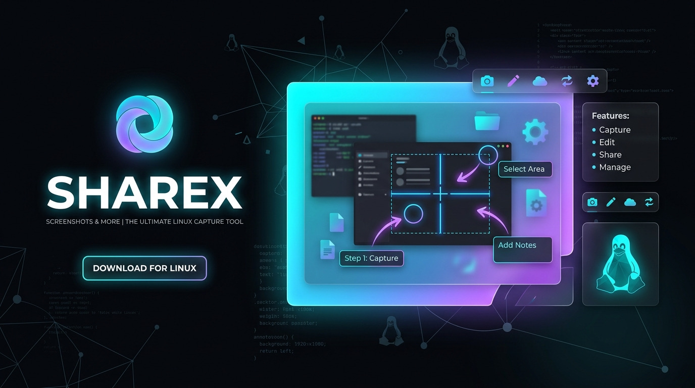

<p align="center">
  
</p>

<h1 align="center">ShareNux — The Modern Linux Screen Capture & Sharing Tool</h1>

<p align="center">
  <b>A ferramenta definitiva de captura de tela, anotação e compartilhamento de arquivos para Linux (Wayland & X11), construída sobre a robustez do ShareX.</b>
</p>

<div align="center">
  <a href="https://github.com/Edk1990/ShareNux/actions/workflows/linux-build.yml"></a>
  <a href="https://github.com/Edk1990/ShareNux/actions/workflows/build.yml"></a>
  <a href="./LICENSE.txt"></a>
  
  
</div>

<br>

---

## 🐧 O que é o ShareNux?

O **ShareNux** nasce da evolução e modernização do consagrado **ShareX** para o ecossistema Linux moderno. Enquanto o ShareX original foi desenhado ao longo de 15 anos para a API Win32 do Windows, o **ShareNux** adota uma arquitetura limpa, modular e orientada aos padrões do Linux:

1. **Filosofia Unix & CLI-First:** Execução ultrarrápida por linha de comando (`sharenux -m region`), integrável diretamente aos atalhos de qualquer Window Manager ou Desktop Environment (i3, Sway, Hyprland, bspwm, GNOME, KDE Plasma).
2. **O Poder dos Uploaders do ShareX:** Preservação do motor completo com **mais de 80 serviços de nuvem** (Imgur, S3, Google Drive, Dropbox, FTP, etc.) e suporte nativo a arquivos de uploader customizado (**`.sxcu`**).
3. **Editor de Imagens Integrado (Avalonia UI + SkiaSharp):** Anotações completas na captura (setas, texto, blur/redação, destaque, recorte) aceleradas por hardware.
4. **Alto Desempenho com .NET 10 Native AOT:** Binário ELF nativo estático único, sem dependência do .NET SDK na máquina do usuário e com tempo de inicialização (*cold start*) de apenas **~15ms**.
5. **Wayland First + X11:** Integração nativa com **XDG Desktop Portals**, **PipeWire** e notificações via **D-Bus**.

---

## 📚 Documentação Técnica do ShareNux

| Documento | Descrição |
| :--- | :--- |
| 📐 [**`ARCHITECTURE.md` (ADR-001)**](docs/linux-port/ARCHITECTURE.md) | Decisões de arquitetura, comparativo técnico e modelagem de camadas do ShareNux. |
| 🗺️ [**`ROADMAP.md`**](docs/linux-port/ROADMAP.md) | Cronograma oficial em 6 Milestones, com tarefas atômicas e critérios de aceite (*Definition of Done*). |
| 🛠️ [**`SETUP_FROM_SCRATCH.md`**](docs/linux-port/SETUP_FROM_SCRATCH.md) | Guia completo passo a passo para configurar o ambiente do zero em Ubuntu, Debian, Fedora, Arch e WSL2. |
| 📋 [**`GITHUB_MANAGEMENT.md`**](docs/linux-port/GITHUB_MANAGEMENT.md) | Guia de acompanhamento de tarefas via GitHub Projects (Kanban), Milestones e Branches. |

---

## 🚦 Status Atual dos Milestones

```
[✅ Milestone 1: Fundação & Desacoplamento do Core] 
         ↓
[⏳ Milestone 2: O Binário CLI Mínimo - ShareNux MVP] 
         ↓
[⏹️ Milestone 3: Captura de Tela Nativa (Wayland/X11)] 
         ↓
[⏹️ Milestone 4: Pipeline de Saída (Clipboard & Notificações D-Bus)] 
         ↓
[⏹️ Milestone 5: Editor de Imagens Integrado (Avalonia UI)] 
         ↓
[⏹️ Milestone 6: Daemon de Atalhos & Empacotamento Oficial (AUR/Flatpak)]
```

* **Milestone 1 — Concluído (100%):** Bibliotecas principais [`ShareX.HelpersLib`](ShareX.HelpersLib/ShareX.HelpersLib.csproj) e [`ShareX.UploadersLib`](ShareX.UploadersLib/ShareX.UploadersLib.csproj) desacopladas e compilando em `net10.0` com suíte de testes xUnit aprovada em [`ShareX.Tests.Linux`](ShareX.Tests.Linux/).
* **Milestone 2 — Próxima Etapa:** Criação do executável CLI `ShareNux` gerado com Native AOT.

---

## ⚡ Como Compilar e Testar no Linux

### Pré-requisitos (Debian/Ubuntu)
```bash
sudo apt update && sudo apt install -y build-essential clang zlib1g-dev libkrb5-dev libdbus-1-dev
```

### Clonar o ShareNux
```bash
git clone https://github.com/Edk1990/ShareNux.git
cd ShareNux
```

### Compilar os Módulos e Rodar a Suíte de Testes
```bash
# Compilar bibliotecas principais em net10.0 puro
dotnet build ShareX.HelpersLib/ShareX.HelpersLib.csproj -f net10.0 -c Release
dotnet build ShareX.UploadersLib/ShareX.UploadersLib.csproj -f net10.0 -c Release

# Executar os testes unitários de compatibilidade SXCU
dotnet test ShareX.Tests.Linux/ShareX.Tests.Linux.csproj -c Release
```

---

## 💻 Comandos da Linha de Comando (`sharenux`)

```bash
# Capturar uma região da tela e fazer upload imediato
sharenux -m region

# Capturar tela inteira e copiar a URL final para a área de transferência
sharenux -m fullscreen -c -n

# Capturar e abrir no Editor de Imagens antes de subir
sharenux -m region -e

# Fazer upload de um arquivo existente usando uma configuração SXCU específica
sharenux /caminho/da/imagem.png --config meu_uploader.sxcu

# Enviar o conteúdo da área de transferência (imagem ou texto)
sharenux -m clipboard
```

---

## 🌐 Créditos e Referências

O **ShareNux** é construído como um fork de modernização multiplataforma do **ShareX**:
* **Projeto Original (Windows Upstream):** [https://github.com/ShareX/ShareX](https://github.com/ShareX/ShareX)
* **Documentação Oficial de Custom Uploaders (.sxcu):** [https://getsharex.com/docs/custom-uploader](https://getsharex.com/docs/custom-uploader)

---

## 📜 Licença

O **ShareNux** é software livre licenciado sob a [GNU General Public License v3.0 (GPL-3.0)](LICENSE.txt).
Créditos integrais aos criadores originais do ShareX e à comunidade de software livre.
