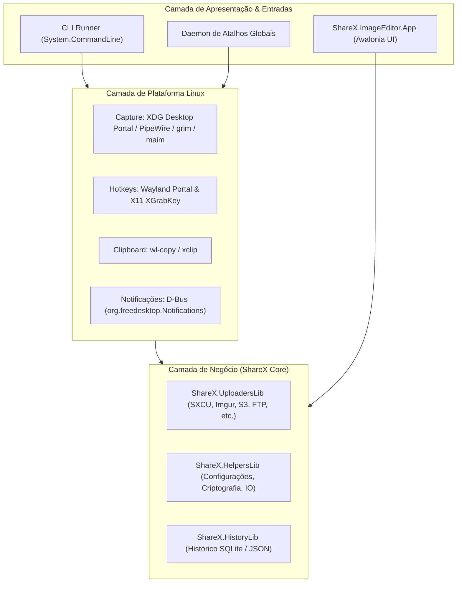

# ADR-001: Arquitetura do Port do ShareX para Linux

> **Status:** Aprovado  
> **Data:** 2026-10-14  
> **Autores:** Equipe de Porting do ShareX  
> **Contexto:** Expansão multiplataforma do ShareX  

---

## 1. Contexto e Problema

O **ShareX** é uma das ferramentas de captura, edição e upload de arquivos mais populares e ricas em recursos do ecossistema Windows. No entanto, sua base de código histórica (iniciada em 2007) apresenta desafios críticos para execução no Linux:

1. **Acoplamento com Windows Forms e Win32:** O executável principal (`ShareX.exe` / `MainForm.cs`) depende fortemente da API Win32 (`user32.dll`, `gdi32.dll`, `dwmapi.dll`), de loops de mensagens (`WndProc`) e de componentes GDI+.
2. **Inviabilidade do Port 1:1:** Tentar emular ou converter dezenas de janelas Windows Forms para Linux é um processo de manutenção inviável e com resultado visual defasado.
3. **Evolução Recente do Repositório:** A própria equipe do ShareX já iniciou o desacoplamento, criando os projetos [`ShareX.Avalonia`](file:///c:/ShareX/ShareX.Avalonia/ShareX.Avalonia.csproj) e [`ShareX.ImageEditor`](file:///c:/ShareX/ShareX.ImageEditor) direcionados para **.NET 10** puro, demonstrando que a interface moderna deve ser baseada em **Avalonia / SkiaSharp**.

---

## 2. Análise do Projeto ShareNix (Lições Aprendidas)

Analisamos o projeto [Francesco149/sharenix](https://github.com/Francesco149/sharenix), uma reimplementação limpa em Go:

### Pontos Positivos Adotados:
* **Filosofia Unix (CLI-First):** Capacidade de executar ações atômicas por linha de comando (`sharex -m region`, `sharex -m fullscreen`, `sharex <arquivo>`), permitindo integração direta com atalhos de Window Managers (i3, Sway, Hyprland, bspwm, KDE, GNOME).
* **Compatibilidade com SXCU:** Preservação do formato de upload customizado do ShareX (`.sxcu`), com variáveis como `$json:...$`, `$regex:...$`, `$filename$`.

### Erros e Limitações do ShareNix a Evitar:
* **Preso ao X11 arcaico:** O ShareNix usava `xgb` (X Go Binding) e extensões Xinerama, tornando-se completamente inoperante no Wayland moderno (Ubuntu 22+, Fedora 38+, Arch, etc.).
* **Dependência de GTK2 antigo:** Utilizava bindings Cgo de GTK 2 para popups e clipboard, gerando problemas de concorrência e dependências legadas.
* **Falta de Interface / Editor:** O autor abriu mão de qualquer interface gráfica ou editor de imagem, limitando severamente a usabilidade para usuários comuns.

---

## 3. Avaliação de Tecnologias

Analisamos três opções de tecnologia para o novo ecossistema Linux:

| Critério | Go (Golang) | Rust | **C# .NET 10 + Native AOT (Escolhido)** |
| :--- | :--- | :--- | :--- |
| **Inicialização (Cold Start)** | ~10ms | ~5ms | **~15ms (sem VM / JIT)** |
| **UI / Editor de Imagem** | Fraco (Fyne / Cgo) | Mediano (Slint / Iced) | **Excelente (Avalonia + SkiaSharp já prontos)** |
| **Aproveitamento de Código** | 0% (reescrever tudo) | 0% (reescrever tudo) | **~75% (UploadersLib, ImageEditor, Helpers)** |
| **Wayland & D-Bus** | Bom via Cgo/godbus | Nativo | **Excelente via Tmds.DBus e P/Invoke limpo** |
| **Binário Final** | Executável único estático | Executável único estático | **Executável ELF único sem dependência de runtime** |

**Decisão:** Adotar **C# .NET 10 com Native AOT** (`<PublishAot>true</PublishAot>`).  
Essa abordagem entrega a mesma velocidade e distribuição em binário único do Go e Rust, mas preserva anos de trabalho já desenvolvidos no motor de uploads (`ShareX.UploadersLib`) e no editor de imagem (`ShareX.ImageEditor`).

---

## 4. Arquitetura do Sistema

A nova aplicação para Linux é dividida em três camadas modulares:

### 4.1. Estratégia de Captura de Tela (Display Servers)
1. **Wayland (Padrão Moderno):**
   * Chamada direta via D-Bus ao `org.freedesktop.portal.Screenshot` e `org.freedesktop.portal.ScreenCast` (PipeWire).
   * **Fallback:** Invocação de utilitários locais do sistema (`grim` + `slurp`) caso os portais não estejam disponíveis.
2. **X11 (Sessões Tradicionais):**
   * Captura direta via XCB/Xlib ou utilitários locais (`maim`, `scrot`).

### 4.2. Estratégia de Atalhos Globais
* Implementada pela factory [`HotkeyHostFactory`](file:///c:/ShareX/ShareX.HelpersLib/Input/HotkeyHostFactory.cs):
  * **Wayland:** `org.freedesktop.portal.GlobalShortcuts`.
  * **X11:** `XGrabKey` nativo através de [`X11HotkeyHost`](file:///c:/ShareX/ShareX.HelpersLib/Input/Linux/X11HotkeyHost.cs).

### 4.3. Pipeline de Processamento e Upload
1. A imagem é capturada em buffer de memória (`byte[]` / `SKBitmap`).
2. Se a flag `-e` (editar) for passada, o buffer é aberto no `ShareX.ImageEditor.App` (Avalonia).
3. A imagem resultante é enviada para o serviço configurado via `ShareX.UploadersLib`.
4. A URL de retorno é copiada para a área de transferência (`wl-copy` ou `xclip`).
5. Uma notificação D-Bus nativa é disparada (`org.freedesktop.Notifications`), permitindo clicar para abrir o link no navegador padrão via `xdg-open`.

---

## 5. Consequências e Benefícios

* **Desacoplamento Seguro:** O código do Windows legado não é quebrado; as bibliotecas compartilhadas passam a compilar para múltiplos alvos (`net10.0;net10.0-windows`).
* **Manutenibilidade:** Código C# tipado, limpo e testável com xUnit.
* **Facilidade de Empacotamento:** O executável compilado com Native AOT é um arquivo binário único que pode ser empacotado em `.deb`, `.rpm`, `PKGBUILD` (AUR), AppImage ou Flatpak sem necessidade de embutir o runtime completo do .NET.
